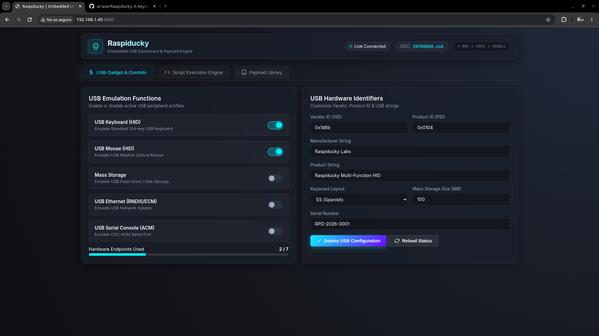
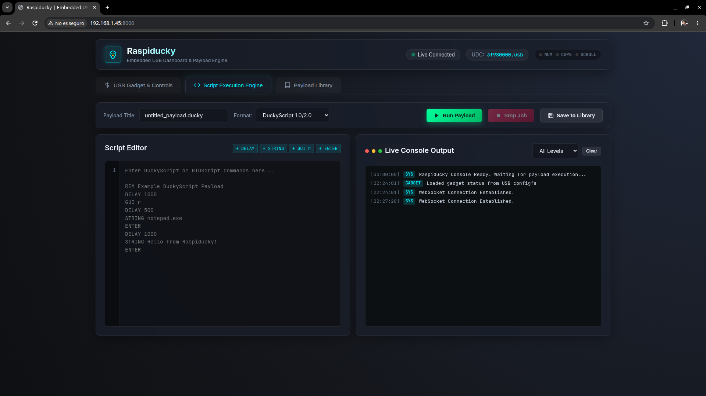
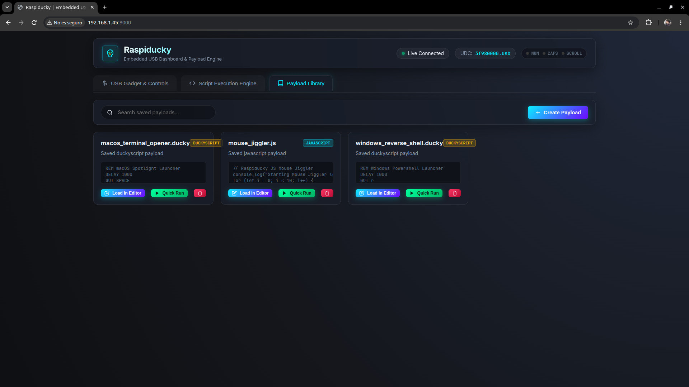

# 🦆⚡ Raspiducky

[](https://sonarcloud.io/summary/overall?id=arrase_Raspiducky)
[](https://sonarcloud.io/summary/overall?id=arrase_Raspiducky)
[](https://sonarcloud.io/summary/overall?id=arrase_Raspiducky)
[](https://sonarcloud.io/summary/overall?id=arrase_Raspiducky)
[](https://sonarcloud.io/summary/overall?id=arrase_Raspiducky)
[](https://sonarcloud.io/summary/overall?id=arrase_Raspiducky)
[](https://sonarcloud.io/summary/overall?id=arrase_Raspiducky)
[](https://sonarcloud.io/summary/overall?id=arrase_Raspiducky)
[](https://sonarcloud.io/summary/overall?id=arrase_Raspiducky)
[](https://sonarcloud.io/summary/overall?id=arrase_Raspiducky)
[](https://sonarcloud.io/summary/overall?id=arrase_Raspiducky)

A modern, high-performance, and lightweight USB Gadget & DuckyScript/HIDScript execution appliance for Raspberry Pi Zero W, Pi 4/5, and compatible Linux SBCs.

Designed to run as a **single Go executable** on lightweight Linux distributions (such as Raspberry Pi OS Lite), Raspiducky turns your SBC into a versatile, multi-function USB automation and HID testing appliance.

📖 **Full Documentation:** [https://arrase.github.io/Raspiducky/](https://arrase.github.io/Raspiducky/)

---

## ✨ Why Raspiducky?

* **Single Executable Binary:** Built in pure Go (`CGO_ENABLED=0`), bundling an embedded REST API, real-time WebSocket hub, CLI runner, and single-page web dashboard via `go:embed`.
* **Plug & Play Linux USB ConfigFS:** Direct orchestration of `/sys/kernel/config/usb_gadget` for runtime composite reconfiguration *without* system reboots.
  * ⌨️ **HID Keyboard:** 8-byte boot-protocol reports with multi-language layout translation (**US**, **ES**, **DE**, **FR**), dead-key support, configurable keystroke speed (`0ms` raw burst or console-safe pacing), and bounded non-hanging `/dev/hidg0` writes.
  * 🖱️ **HID Mouse:** 6-byte composite relative movement (with automatic multi-report splitting for deltas `> ±127`), 15-bit absolute screen positioning (`0..32767`), and button clicks.
  * 💾 **USB Mass Storage (UMS):** Mount ISO or RAW disk image backing files in CD-ROM or read/write Flash Drive modes.
  * 🌐 **USB Network:** Independently selectable **CDC ECM** (Linux/macOS/Android) and **RNDIS** (Windows with automatic Microsoft OS 1.0 `MSFT100` descriptors) with custom MAC addresses.
  * 🔌 **USB Serial:** CDC ACM serial console interface (`/dev/ttyGS0`).
* **Dual Scripting Engines:**
  * **Direct DuckyScript Compiler (`.txt` / `.ducky`):** Validates and compiles DuckyScript 1.0–3.0 syntax (`STRING`..`END_STRING`, `STRINGLN`..`END_STRINGLN`, `REM_BLOCK`..`END_REM`, `REPEAT`, `LAYOUT`, `TYPING_SPEED`/`STRINGDELAY`, `WAIT_LED`, `MOUSE_*`, `HOLD`/`RELEASE`) directly into native HID instructions with line-accurate compile-time error reporting.
  * **JavaScript Engine (`.js` via Goja):** Pure Go ECMAScript 5.1+ runtime with native USB HID bindings (`type()`, `press()`, `hold()`, `release()`, `delay()`, `layout()`, `typingSpeed()`, `waitLED()`, `mouseMove()`, `mouseMoveTo()`, `mouseClick()`), instant cancellation (`vm.Interrupt`), and automatic release of held keys/buttons on exit.
* **Host Keyboard LED State Listener:** Reads EP0 `SET_REPORT` LED updates from `/dev/hidg0` (`NUMLOCK`, `CAPSLOCK`, `SCROLLLOCK`) with `no_out_endpoint=1`, enabling host synchronization without consuming dedicated OUT hardware endpoints.
* **Hardened Web Dashboard & API:** Protected by strict `Content-Security-Policy`, `X-Frame-Options: DENY`, and same-origin (`Sec-Fetch-Site` / `Origin`) CSRF enforcement.

---

## 🖼️ Web Dashboard Showcase

A sleek, dark-mode single-page dashboard with real-time WebSocket log streaming, a payload editor, job manager, typing delay controls, and live USB endpoint budget tracking.

| Main Dashboard & Gadget Control | Script Editor & Live Execution Console |
| :---: | :---: |
|  |  |

<br>
<p align="center">
  <b>Payload Library & Job Manager</b><br><br>
  
</p>

---

## 🚀 Getting Started

### ⚡ 1. Automated Installation (Recommended)

Run this single command on your Raspberry Pi (or compatible Linux target):

```bash
curl -fsSL https://raw.githubusercontent.com/arrase/Raspiducky/master/install.sh | sudo sh
```

**What does this script do?**
* Automatically detects your CPU architecture (`armv6l`, `armv7l`, `aarch64`, `x86_64`) and downloads the latest release binary into a secure temporary directory.
* Configures the `dtoverlay=dwc2,dr_mode=peripheral` kernel overlay under `[all]`, loads `dwc2` and `libcomposite`, mounts `debugfs`, and sets up `udev` rules for `/dev/hidg*`.
* Installs and starts `raspiducky.service` as a **background systemd service** while preserving your saved layout and gadget profile across updates and reboots.

*Note: Running this command again in the future will automatically update Raspiducky to the latest GitHub release.*

### 🌐 2. Using the Application

Once installed via the script above, **Raspiducky is already running in the background!**

Open your web browser on any device in the same network and navigate to:

```text
http://<raspberry-pi-ip>:8000
```

From this live dashboard, you can configure USB gadget functions, select keyboard layout and typing delay (`10ms` default for broad host/console compatibility, or `0ms` for maximum raw speed), manage payloads, and execute scripts interactively.

---

## 💻 Hardware Compatibility & USB OTG Support

> [!WARNING]
> USB Gadget mode requires a Single Board Computer (SBC) where the USB OTG controller (`dwc2`, `dwc3`, or `musb`) is wired directly to a Micro-USB or USB-C OTG port **without an onboard USB Hub chip**.
>
> * ✅ **Supported RPi Ports**: Raspberry Pi Zero / Zero W / Zero 2 W (Micro-USB data port), Raspberry Pi A / A+ / 3A+ (Type-A OTG port), Raspberry Pi 4B / 5 (USB-C power/data port with `dr_mode=peripheral`).
> * ❌ **Unsupported RPi Ports**: Standard Type-A ports on Raspberry Pi 1B, 2B, 3B, and 3B+ sit behind an onboard LAN9512/LAN9514/LAN7515 USB hub chip, locking them into USB Host mode.

### 🚦 Hardware Endpoint Limits

USB Device Controllers enforce a physical ceiling on the total number of active hardware endpoints (`EP0` + `IN` + `OUT`) across all enabled composite functions:

* **Raspberry Pi Zero / Zero 2 W / A+ / 3A+ / 4B / 5 (`dwc2` Controller)**: **7 total hardware endpoints** (`num_dev_ep: 7`, i.e., `1 EP0 + 6 function endpoints`).
* **Rockchip RK3399 / RK3588 & `dwc3` SBCs (e.g., Rock Pi 4/5, Orange Pi 5)**: Up to **15+ endpoints** depending on SoC synthesis.

**Hardware Endpoint Cost per Function:**
* 🔹 **Control Endpoint (`EP0`)**: `1` endpoint *(allocated whenever any USB function is enabled)*
* ⌨️ **HID Keyboard (`hid.usb0`)**: `1` endpoint *(Interrupt IN; `no_out_endpoint=1` routes LED reports via `EP0`)*
* 🖱️ **HID Mouse (`hid.usb1`)**: `1` endpoint *(Interrupt IN; `no_out_endpoint=1`)*
* 💾 **Mass Storage (`mass_storage.usb0`)**: `2` endpoints *(Bulk IN + Bulk OUT)*
* 🌐 **USB Ethernet — RNDIS (`rndis.usb0`)**: `3` endpoints *(Interrupt IN + Bulk IN + Bulk OUT)*
* 🌐 **USB Ethernet — CDC ECM (`ecm.usb0`)**: `3` endpoints *(Interrupt IN + Bulk IN + Bulk OUT)*
* 🔌 **USB Serial Console (`acm.usb0`)**: `3` endpoints *(Interrupt IN + Bulk IN + Bulk OUT)*

*The Web Dashboard and REST API automatically query `/sys/kernel/debug/usb/<udc>/hw_params` (`maxEndpoints` / `usedEndpoints`) and prevent deploying combinations that exceed your board's physical UDC budget.*

### 📋 Supported Boards & Binary Asset Matrix

| Asset Name | Architecture | Target SBC Boards | USB OTG Port |
|---|---|---|---|
| **`raspiducky-linux-armv6`** | ARMv6 (32-bit) | • **RPi Zero / Zero W**<br>• **RPi Model A / A+** | Micro-USB / Type-A OTG |
| **`raspiducky-linux-armv7`** | ARMv7 (32-bit) | • **RPi 3A+** *(32-bit OS)*<br>• **RPi CM 3**<br>• **Banana Pi M2 Zero/M1**<br>• **Orange Pi Zero/One/PC**<br>• **NanoPi NEO** | Micro-USB / Type-A OTG |
| **`raspiducky-linux-arm64`** | ARM64 (64-bit) | • **RPi Zero 2 W** *(64-bit OS)*<br>• **RPi 4B / 5** *(USB-C)*<br>• **RPi 3A+** *(64-bit OS)*<br>• **RPi CM4 / CM5**<br>• **Orange Pi Zero 2/3/5**<br>• **NanoPi R2S/R4S/NEO3**<br>• **Radxa Rock Pi**<br>• **Pine64 Quartz64** | USB-C / Micro-USB |
| **`raspiducky-linux-amd64`** | x86_64 (64-bit) | • **Standard PC / Intel NUC** *(Linux with USB OTG/UDC hardware or `dummy_hcd` testing)* | USB-C OTG |

---

## 📜 Scripting Examples

Raspiducky supports both DuckyScript 1.0–3.0 and an ECMAScript 5.1+ JavaScript API.

### 🦆 DuckyScript Example (`hello.txt`)
```duckyscript
REM Standard & DuckyScript 3.0 Block Payload
DELAY 1000
GUI r
DELAY 500
STRINGLN notepad.exe
DELAY 800
STRINGLN
Hello World from Raspiducky!
Multi-line blocks and 60Hz console-safe newlines work out of the box.
END_STRINGLN
```

### ⚡ JavaScript HIDScript Example (`hello.js`)
```javascript
// Set keyboard layout to Spanish and typing speed (15ms delay, 5ms jitter)
layout("es");
typingSpeed(15, 5);

// Open Run dialog on Windows
press("GUI R");
delay(500);
type("notepad.exe\n");
delay(800);

// Type text with full Spanish keymap & dead-key support
type("¡Hola desde el motor JS de Raspiducky!\n");

// Wait up to 10s for target user to toggle NumLock
var state = waitLED("NUM", 10000);
log("NumLock active:", state.numLock);
```

---

## 🛠️ Advanced Usage & CLI

### Starting the Daemon Manually
If you built from source or did not use the automated installer, start `raspiducky` in daemon mode with root privileges:

```bash
sudo ./raspiducky daemon -port :8000 -storage /var/lib/raspiducky
```
> *Optional flags: `-layout <US|ES|DE|FR>` overrides the saved keyboard layout; `-delay <ms>` overrides the saved inter-keystroke delay (e.g., `-delay 0` or `-delay 10`).*

### Executing Scripts via CLI (Headless & Boot Automation)
Execute any DuckyScript (`.txt`, `.ducky`) or JavaScript (`.js`) file directly from the terminal or `crontab`:

```bash
sudo raspiducky run payloads/hello_world.txt -layout ES -delay 10
```

When `raspiducky.service` is running, `raspiducky run` **automatically delegates execution to the active daemon** via `http://127.0.0.1:8000` (avoiding `/dev/hidg0` device contention and streaming logs to connected Web Dashboard clients), and seamlessly falls back to direct local HID execution when running standalone.

---

## 🏗️ Building from Source

Requires **Go 1.26+** (`CGO_ENABLED=0`, zero external C dependencies).

### Native Build (On Target Device)
```bash
git clone https://github.com/arrase/Raspiducky.git
cd Raspiducky
go build -ldflags="-s -w -X main.version=dev" -o build/raspiducky ./cmd/raspiducky
```

### Cross-Compiling for Specific Targets

* **Raspberry Pi Zero / Zero W (ARMv6)**:
  ```bash
  CGO_ENABLED=0 GOOS=linux GOARCH=arm GOARM=6 go build -ldflags="-s -w" -o build/raspiducky-linux-armv6 ./cmd/raspiducky
  ```
* **Raspberry Pi 3A+ / Banana Pi M2 Zero / Orange Pi (ARMv7 32-bit)**:
  ```bash
  CGO_ENABLED=0 GOOS=linux GOARCH=arm GOARM=7 go build -ldflags="-s -w" -o build/raspiducky-linux-armv7 ./cmd/raspiducky
  ```
* **Raspberry Pi Zero 2 W / Pi 4 / Pi 5 / Orange Pi 5 / Radxa (ARM64 64-bit)**:
  ```bash
  CGO_ENABLED=0 GOOS=linux GOARCH=arm64 go build -ldflags="-s -w" -o build/raspiducky-linux-arm64 ./cmd/raspiducky
  ```

---

## 📐 Architecture

```text
                                  +---------------------------------------+
                                  |     Web Browser / REST / WS / CLI     |
                                  +-------------------+-------------------+
                                                      |
                                                      v
+---------------------------------------------------------------------------------------------------+
| Raspiducky (Single Go Executable)                                                                 |
|                                                                                                   |
|  +-------------------+   +-------------------------+   +---------------------------------------+  |
|  | Embedded Web UI   |   | REST, WS & Persistence  |   | Direct DuckyScript Compiler &         |  |
|  | (pkg/api/web)     |   | (pkg/api)               |   | Goja JS Engine (pkg/scripting)        |  |
|  +-------------------+   +------------+------------+   +-------------------+-------------------+  |
|                                       |                                    |                      |
|                                       v                                    v                      |
|                         +----------------------------------------------------+                    |
|                         |       ConfigFS & HID Hardware Controllers          |                    |
|                         |       (pkg/gadget, pkg/hid)                        |                    |
|                         +-------------------------+--------------------------+                    |
+---------------------------------------------------|-----------------------------------------------+
                                                    |
                                                    v
                              +-------------------------------------------+
                              | Linux Kernel ConfigFS & /dev/hidgX        |
                              +-------------------------------------------+
```

---

## 📡 REST API Reference

| Endpoint | Method | Description |
| :--- | :--- | :--- |
| `/api/gadget` | `GET` | Retrieve active USB gadget configuration, UDC, and endpoint usage |
| `/api/gadget` | `POST` | Validate, save, and deploy USB gadget parameters |
| `/api/scripts` | `GET` | List all saved payload scripts |
| `/api/scripts` | `POST` | Save or update a payload script (`201 Created`) |
| `/api/scripts/{name}` | `DELETE` | Delete a saved payload script (`204 No Content`) |
| `/api/job` | `GET` | Retrieve current or last script execution job status |
| `/api/run` | `POST` | Trigger script execution (with optional `layout` & `typingDelayMs` overrides) |
| `/api/stop` | `POST` | Immediately interrupt active script execution and HID writes |
| `/api/ws` | `GET` | Real-time WebSocket stream (`log`, `led_state`, `gadget_status`, `job_status`) |

---

## 📄 License
This project is released under the **MIT License**.
