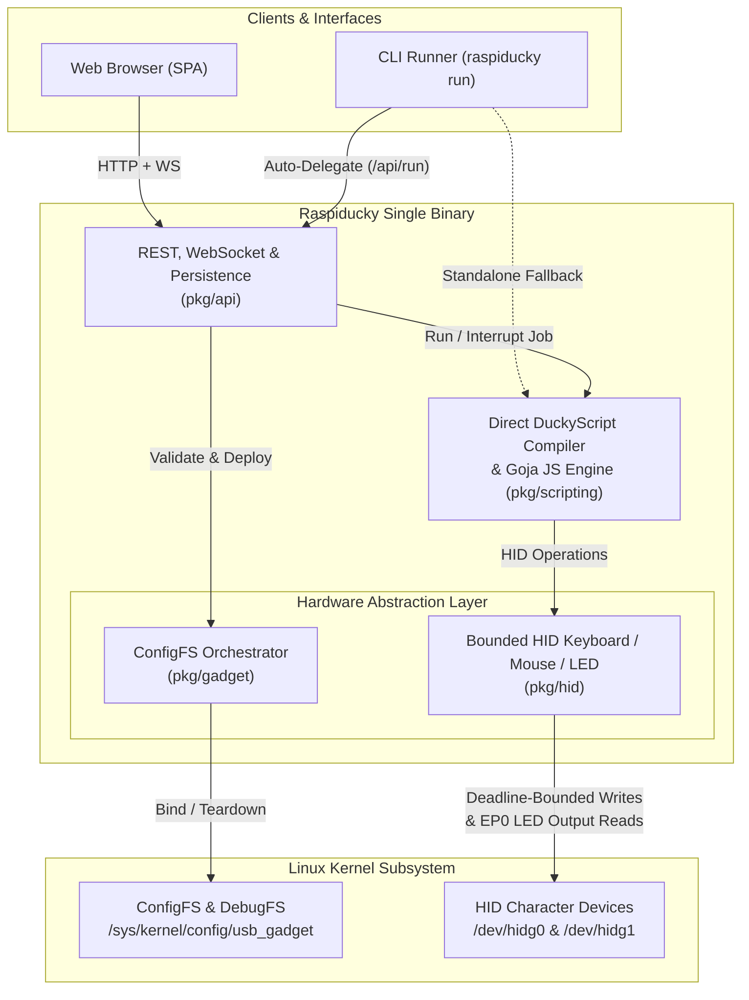

# Architecture & Core Engine

Raspiducky is architected as a lightweight, high-performance, single-binary appliance designed for Linux Single Board Computers (SBCs) equipped with USB OTG hardware controllers. It abstracts kernel USB composite gadget drivers and raw HID character devices behind a hardened REST/WebSocket API, embedded Web Dashboard, CLI runner, and dual scripting runtime.

---

## 🏗️ High-Level System Architecture

The application is written in pure Go 1.26+ (`CGO_ENABLED=0`) with zero external shared library dependencies, a minimal memory footprint (~15–25 MB RSS), and instant startup.

The single binary embeds the entire web frontend using Go's native `go:embed` filesystem (`embed.FS`). When started in `daemon` mode, Raspiducky serves both the single-page application (SPA) and the REST/WebSocket API; when invoked via `raspiducky run`, the CLI automatically delegates execution to the active daemon (if reachable) to avoid `/dev/hidg*` contention, or executes directly against hardware in standalone headless setups.



---

## 🐧 Linux Kernel ConfigFS & Bounded HID I/O

Raspiducky leverages the Linux kernel's **ConfigFS** (`usb_gadget`) interface at `/sys/kernel/config/usb_gadget/`. Unlike legacy single-purpose kernel modules (`g_hid`, `g_ether`), ConfigFS constructs and reconfigures composite USB devices dynamically at runtime without module reloads or reboots.

### 1. Gadget Lifecycle & Bindings
1. **Creation**: `/sys/kernel/config/usb_gadget/raspiducky` is populated with `idVendor`, `idProduct`, `bcdUSB` (`0x0200`), composite IAD device class (`0xEF` / `0x02` / `0x01`), and `0x409` string descriptors.
2. **Function Definition**: Enabled functions are instantiated inside `functions/`:
   - `hid.usb0`: HID Keyboard (`no_out_endpoint=1`, 8-byte boot keyboard report descriptor)
   - `hid.usb1`: HID Mouse (`no_out_endpoint=1`, 6-byte composite relative + absolute report descriptor)
   - `mass_storage.usb0`: USB Mass Storage (`lun.0` backing image, `cdrom`, `ro`, `removable=1`)
   - `rndis.usb0`: Windows RNDIS network interface (with Microsoft OS 1.0 `MSFT100` descriptors)
   - `ecm.usb0`: CDC ECM network interface (Linux / macOS / Android)
   - `acm.usb0`: CDC ACM serial console (`/dev/ttyGS0`)
3. **Configuration & Binding**: Function directories are symlinked into `configs/c.1/`.
4. **UDC Activation**: Writing the detected controller name from `/sys/class/udc` (e.g., `20980000.usb` or `fe980000.usb`) into `UDC` attaches the composite device to the USB bus.

### 2. Resilient Character Device I/O (`/dev/hidg*`)
Once bound, the kernel exposes character devices:
- `/dev/hidg0`: Keyboard reports (8-byte IN reports; 1-byte LED `SET_REPORT` output updates routed over `EP0`).
- `/dev/hidg1`: Mouse reports (6-byte IN reports with Report ID `0x01` for relative motion and `0x02` for absolute coordinates).

!!! info "Non-Hanging Write Deadlines & Instant Cancellation"
    Standard blocking writes to `/dev/hidg*` can stall indefinitely if a USB host suspends polling (`write_pending`) or resets the bus. Raspiducky wraps `/dev/hidg*` descriptors in `hidWriter` (`pkg/hid/device.go`), applying `100ms` per-attempt deadlines, `25ms` transient USB error retries (`EAGAIN` / `ESHUTDOWN`), a bounded `1.5s` timeout (`ErrHostNotPolling`) when unattached, and instant `Interrupt()` wakeup on `POST /api/stop` or `SIGINT`.

---

## 📦 Package Architecture

The repository is structured into focused Go packages under `cmd/` and `pkg/`:

```text
cmd/raspiducky/   # Daemon & CLI entrypoint, flag parsing, and smart daemon delegation
pkg/
├── api/          # HTTP REST handlers, CSRF/CSP middleware, WebSocket hub, job runner,
│   └── web/      # Embedded dark-mode SPA static assets (go:embed)
├── gadget/       # ConfigFS orchestrator, UDC discovery, teardown, and endpoint accounting
├── hid/          # Deadline-bounded /dev/hidg* I/O, keymaps (US/ES/DE/FR), mouse, and LED watcher
└── scripting/    # Direct DuckyScript 1.0–3.0 compiler and Goja ECMAScript 5.1+ engine
```

### `pkg/gadget`
Manages the full ConfigFS lifecycle (`Apply`, `Teardown`, UDC bind/unbind) and endpoint budget enforcement:
- `config.go`: Validates VID/PID hex strings, MAC addresses, and backing storage parameters, and computes exact hardware endpoint consumption (`EP0` + enabled functions).
- `gadget.go`: Queries `/sys/kernel/debug/usb/<udc>/hw_params` (`num_dev_ep`) or sysfs endpoint directories, sets `no_out_endpoint=1` on HID functions, configures Microsoft OS descriptors when RNDIS is active, and performs clean reverse-order ConfigFS teardown before redeployment.

### `pkg/hid`
Implements USB Human Interface Device protocols and host state synchronization:
- `device.go`: Manages lazy-opened `O_WRONLY|O_SYNC` file handles with write deadlines, transient USB error retries, and immediate `Interrupt()` cancellation.
- `keyboard.go`: Translates Unicode strings and key combo tokens into 8-byte HID reports with crisp decoupled hold timing (`2ms` at `0ms` delay; `5–20ms` when `delay > 0`), dedicated `KeyEnter` hold/settle (`20ms` + `25ms`) for 60Hz/console hosts, CRLF normalization, 2-step dead-key sequences (`dead-key + Space`), and automatic release of held keys.
- `keymap.go` & `keycodes.go`: Full rune and token lookup tables (including smart-quote/dash/NBSP normalization) for **US**, **ES**, **DE**, and **FR** layouts.
- `mouse.go`: Emits 6-byte relative (`0x01`, auto-splitting deltas larger than `±127`) and absolute (`0x02`, `0..32767`) HID reports, plus automatic button release cleanup.
- `led.go`: Continuously polls `/dev/hidg0` for 1-byte LED output reports (`NumLock`, `CapsLock`, `ScrollLock`) and fans updates out to subscribers (`waitLED` / `WAIT_LED` and WebSocket clients).

### `pkg/scripting`
Executes automated payloads with deterministic cleanup:
- `duckyscript.go`: Directly validates and compiles DuckyScript 1.0/2.0/3.0 source into typed `[]Instruction` opcodes (no fragile string-concatenated JS transpilation), reporting exact `line N:` syntax or key-combo errors before a single keystroke is sent.
- `engine.go`: Executes compiled DuckyScript instructions or [Goja](https://github.com/dop251/goja) ECMAScript 5.1+ scripts, using uncatchable `vm.Interrupt` on cancellation and guaranteeing `ReleaseHeldKeys()` and `ReleaseButtons()` on exit.

### `pkg/api`
Provides HTTP, WebSocket, job lifecycle, and file persistence:
- `server.go`: Registers REST routes, `Content-Security-Policy` / `X-Frame-Options` headers, `1 MB` request body limits, and `Sec-Fetch-Site` / `Origin` same-origin enforcement.
- `gadget.go` & `scripts.go`: Persist `gadget_config.json`, auto-allocated sparse FAT/raw `storage.img` files, and sanitized payload scripts in `/var/lib/raspiducky`.
- `runner.go` & `websocket.go`: Coordinate single-active-job execution, instant `Stop()` interruption, atomic initial WebSocket state snapshots (`led_state`, `gadget_status`, `job_status`), and live log streaming.
