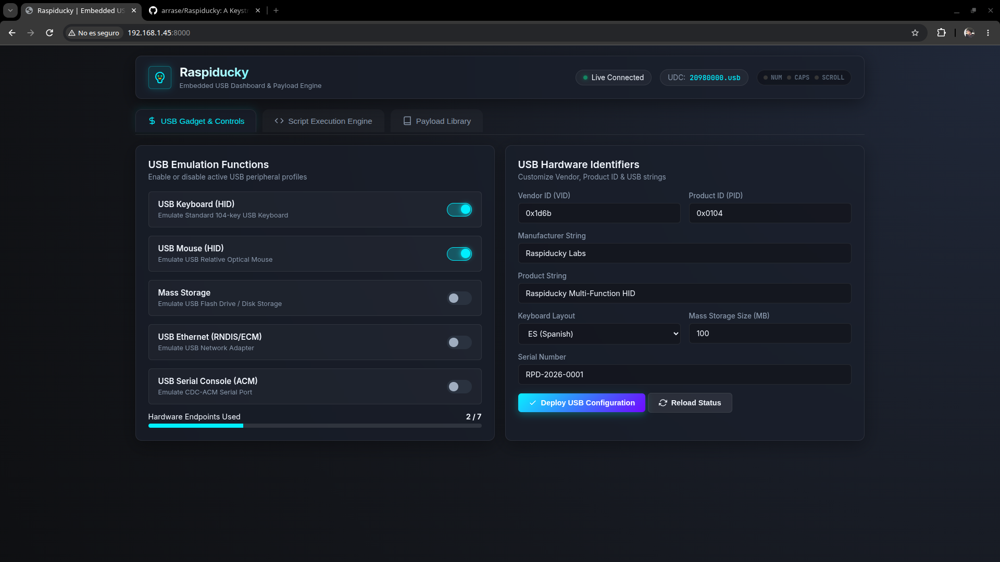
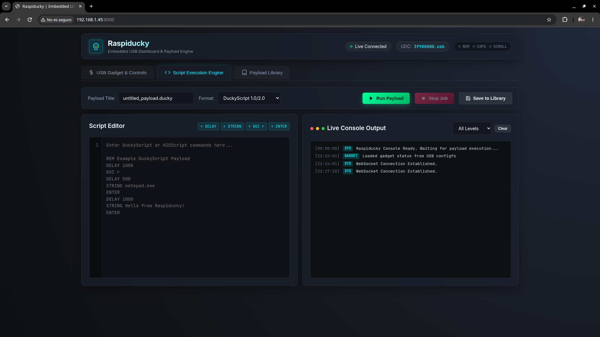
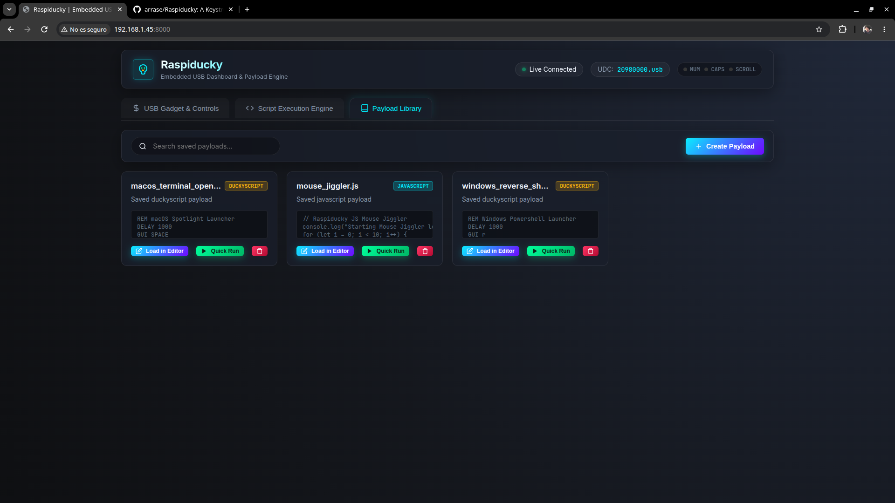

---
hide:
  - toc
---

  

    <i class="fa-solid fa-microchip" aria-hidden="true"></i>
    USB Gadget &amp; HID Appliance
  

  <h1>Raspiducky</h1>
  
A modern, high-performance USB Gadget and DuckyScript/HIDScript execution appliance for Raspberry Pi and Linux SBCs, featuring zero-reboot ConfigFS orchestration, dual scripting engines, and an embedded web dashboard.

  

    
    
    
    
  

  

    
    
    
    
    
    
    
    
    
    
  

  <h2>Key Features</h2>
  Core capabilities &amp; hardware integration

  

    <i class="fa-solid fa-cube feature-icon" aria-hidden="true"></i>
    <h3>Single Binary Architecture</h3>
    
Built in modern Golang with zero runtime external dependencies and an embedded Web UI via <code>go:embed</code>.

  

  

    <i class="fa-solid fa-microchip feature-icon" aria-hidden="true"></i>
    <h3>Linux Kernel ConfigFS</h3>
    
Direct interaction with <code>/sys/kernel/config/usb_gadget</code> and <code>/dev/hidg*</code> char devices for dynamic gadget configuration without reboots.

  

  

    <i class="fa-solid fa-code feature-icon" aria-hidden="true"></i>
    <h3>Dual Scripting Engine</h3>
    
Native execution of standard Hak5 Rubber Ducky scripts (<code>.txt</code>) and advanced ECMAScript 5.1+ JavaScript payloads (<code>.js</code>).

  

  

    <i class="fa-solid fa-lightbulb feature-icon" aria-hidden="true"></i>
    <h3>Host LED Listener</h3>
    
Monitors output reports from <code>/dev/hidg0</code> (<code>NUMLOCK</code>, <code>CAPSLOCK</code>, <code>SCROLLLOCK</code>) enabling target-host synchronization and trigger-based execution.

  

  

    <i class="fa-solid fa-gauge-high feature-icon" aria-hidden="true"></i>
    <h3>Web Dashboard &amp; REST API</h3>
    
Modern dark-mode SPA with real-time WebSocket log streaming, script editor, job manager, and live gadget controls.

  

  

    <i class="fa-solid fa-layer-group feature-icon" aria-hidden="true"></i>
    <h3>Multi-Board Support</h3>
    
Cross-compiled binaries for ARMv6, ARMv7, ARM64, and AMD64 targeting Raspberry Pi Zero, Pi 3, Pi 4, Pi 5, Orange Pi, and NanoPi.

  

  <h2>Screenshot Gallery</h2>
  Embedded dark-mode SPA &amp; live console

| Main Dashboard & Gadget Control | Script Editor & Live Execution Console | Payload Library & Job Manager |
| :---: | :---: | :---: |
|  |  |  |

  <h2>Documentation</h2>
  Technical architecture &amp; user guides

  <a href="architecture/" class="feature-card">
    

      <i class="fa-solid fa-sitemap feature-icon" aria-hidden="true"></i>
      Read →
    

    <h3>Architecture &amp; Core Engine</h3>
    
High-level system architecture, single-binary Go design, ConfigFS kernel interaction, and package breakdown.

  </a>

  <a href="usb-gadgets/" class="feature-card">
    

      <i class="fa-solid fa-usb feature-icon" aria-hidden="true"></i>
      Read →
    

    <h3>USB Gadget Functions</h3>
    
Technical breakdown of Keyboard, Mouse, Mass Storage, CDC-ECM/RNDIS Network, and ACM Serial interfaces.

  </a>

  <a href="scripting/" class="feature-card">
    

      <i class="fa-solid fa-terminal feature-icon" aria-hidden="true"></i>
      Read →
    

    <h3>DuckyScript &amp; JS Engines</h3>
    
Dual scripting runtime guide, Hak5 Rubber Ducky syntax, Goja JavaScript API reference, and host LED listeners.

  </a>

  <a href="web-dashboard-api/" class="feature-card">
    

      <i class="fa-solid fa-globe feature-icon" aria-hidden="true"></i>
      Read →
    

    <h3>Web Dashboard &amp; REST API</h3>
    
Single Page Application features, REST endpoints reference, and WebSocket real-time event streaming.

  </a>

  <a href="hardware-compatibility/" class="feature-card">
    

      <i class="fa-solid fa-microchip feature-icon" aria-hidden="true"></i>
      Read →
    

    <h3>Hardware &amp; SBC Matrix</h3>
    
USB OTG controller types, DWC2 vs DWC3 IN endpoint hardware limits, supported boards, and binary assets.

  </a>

  <a href="cli-automation/" class="feature-card">
    

      <i class="fa-solid fa-gears feature-icon" aria-hidden="true"></i>
      Read →
    

    <h3>CLI &amp; Headless Automation</h3>
    
Daemon mode flags, headless payload execution, systemd integration, and boot-time crontab automation.

  </a>

  <a href="installation/" class="feature-card">
    

      <i class="fa-solid fa-download feature-icon" aria-hidden="true"></i>
      Read →
    

    <h3>Installation &amp; Building</h3>
    
One-line automated installation script, cross-compilation instructions, and building from source.

  </a>

